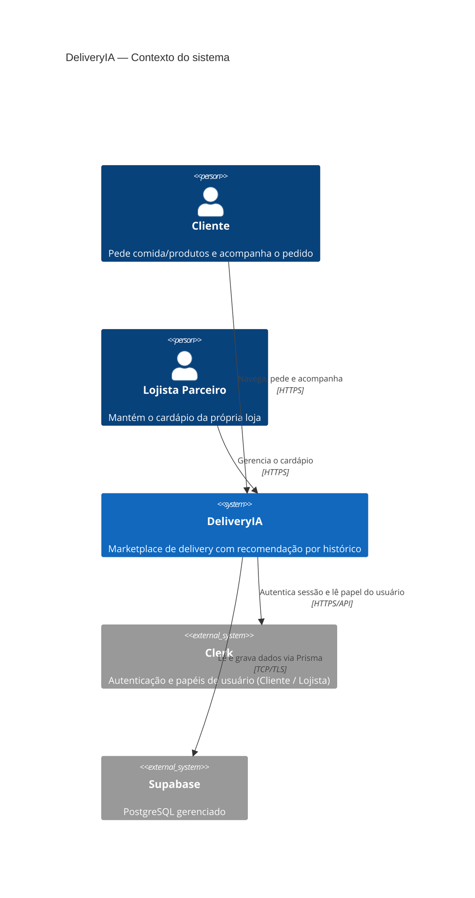
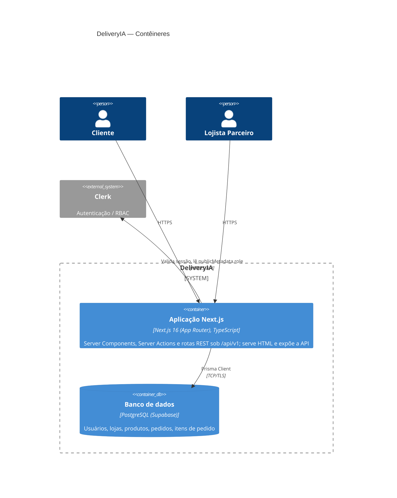
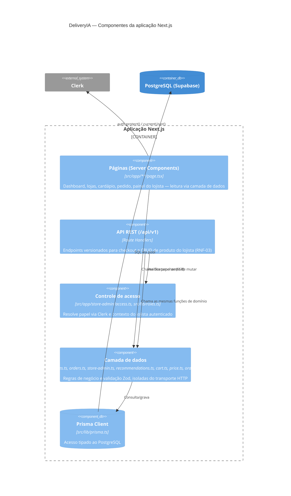
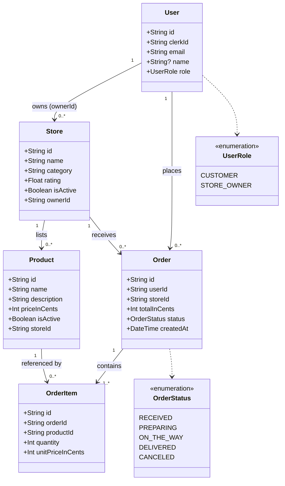
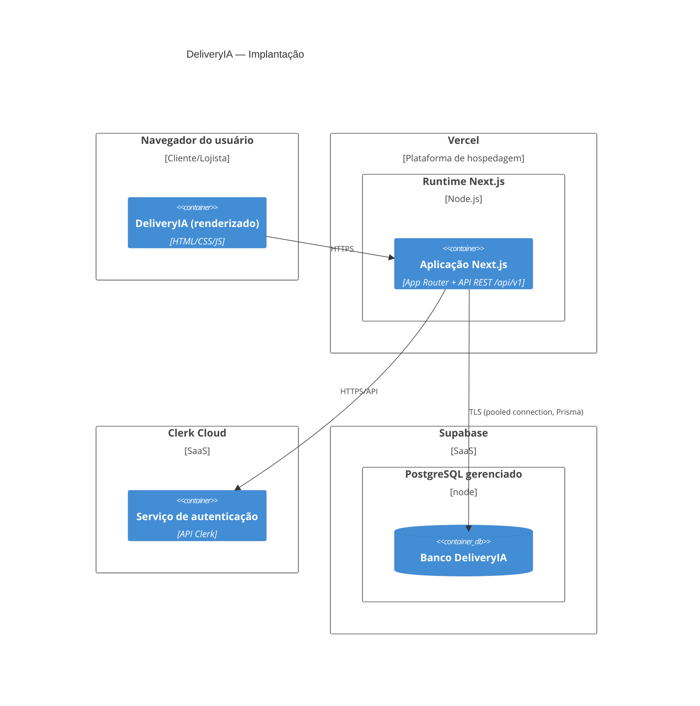

# 10. Modelos C4 — DeliveryIA

Contexto, contêineres, componentes, classes (modelo de domínio) e implantação, em Mermaid. Reflete o código real em `src/` e `prisma/schema.prisma` nesta data — não um desenho aspiracional.

## 10.1 Diagrama de Contexto

## 10.2 Diagrama de Contêineres

## 10.3 Diagrama de Componentes (dentro do contêiner Next.js)

## 10.4 Diagrama de Classes (modelo de domínio)

> `OrderItem.unitPriceInCents` é um *snapshot* do preço no momento da compra (decisão registrada em `openspec/changes/archive/.../carrinho-checkout/design.md`), por isso não há uma referência viva a `Product.priceInCents`.

## 10.5 Diagrama de Implantação

## Status de publicação

Este diagrama de implantação descreve a topologia **alvo** (Vercel + Supabase + Clerk), consistente com `docs/architecture.md`. A publicação efetiva em produção — com endereço e credenciais de acesso — depende das contas e tokens listados em `openspec/roadmap.md` → "Pendências manuais", ainda não fornecidos.
